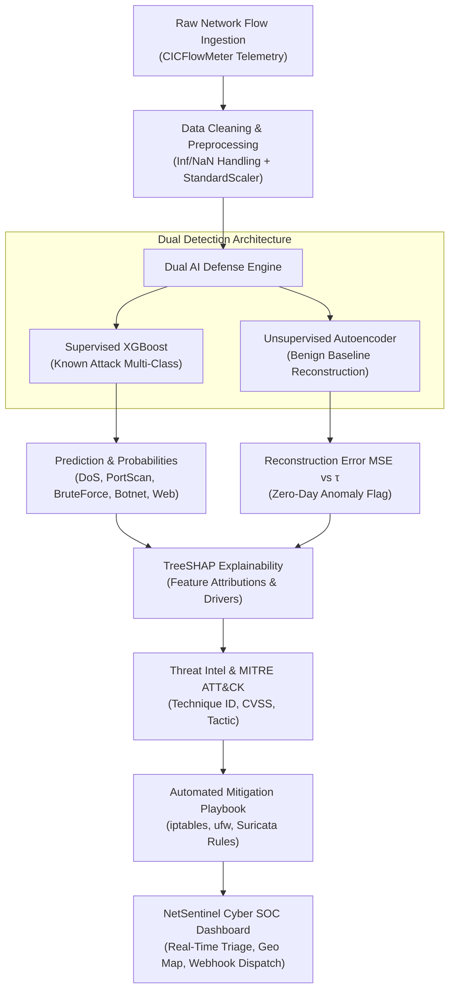

# 🛡️ NetSentinel SOC — AI-Powered Network Intrusion Detection Dashboard

> **Day 17 of 30 Projects in 30 Days**  
> **Domain:** Cybersecurity + Machine Learning | **Level:** Advanced  
> *Classifies network flows as normal or attack, flags zero-day anomalies, and explains incident drivers in plain English.*

[](https://www.python.org/)
[](https://xgboost.readthedocs.io/)
[](https://shap.readthedocs.io/)
[](https://streamlit.io/)
[](LICENSE)
[](tests/)

---

## 📌 Executive Overview

Modern Security Operations Centers (SOCs) are inundated with millions of raw NetFlow/IPFIX records per hour. Traditional signature-based Intrusion Detection Systems (IDS) like Snort and Suricata struggle with two fatal failure modes:
1. **Zero-Day Blindspots:** Novel or polymorphic attack payloads slip past static signature rules.
2. **Alert Fatigue:** Opaque black-box ML classifiers output bare confidence numbers without explaining *why* a packet flow was flagged, forcing tier-1 analysts to spend hours manually inspecting PCAPs.

**NetSentinel SOC** solves this with a **Dual-Engine AI Defense Pipeline**:
- **Supervised Classifier (XGBoost):** Multi-class discrimination across known attack classes (`DoS/DDoS`, `PortScan`, `BruteForce`, `Botnet C2`, and `Web Attack`) tuned on the **CIC-IDS2017** benchmark standard.
- **Unsupervised Anomaly Detector (Neural Autoencoder):** Deep autoencoder bottleneck `(25 → 14 → 8 → 14 → 25)` trained exclusively on benign baselines to identify uncharacterized zero-day intrusions via reconstruction error spikes ($MSE(x, \hat{x}) > \tau$).
- **Analyst-Friendly Explainability (TreeSHAP):** Translates complex mathematical Shapley feature attributions into plain-English cyber narratives (e.g. *"Abnormal SYN Flag count (+0.48) and flow packet rate exceeding 15,000 pkts/s pushed model toward DoS Flood"*).
- **Automated Mitigation Playbooks:** Synthesizes immediate, copy-pasteable firewall commands (`iptables`, `ufw`) and Snort/Suricata IDS rules, mapped to the **MITRE ATT&CK® Enterprise Framework**.

---

## 🏗️ Architecture & Workflow



---

## ⚙️ Tech Stack & Why It Fits

| Technology | Role | Why It Fits |
| :--- | :--- | :--- |
| **Python 3.9+** | Core runtime | Standard language for data engineering, ML, and cybersecurity tooling. |
| **pandas & scikit-learn** | Data pipeline & scaling | High-throughput tabular processing, standardizing continuous flow metrics. |
| **XGBoost** | Supervised Detection | State-of-the-art gradient boosted trees for structured tabular network telemetry with class weighting. |
| **Neural Autoencoder (MLP)** | Zero-Day Detection | Learns compressed representations of normal network traffic; reconstruction error detects unknown anomalies. |
| **SHAP (TreeExplainer)** | Model Explainability | Computes exact game-theoretic feature contributions in milliseconds for live triage. |
| **Streamlit + Plotly** | Cyber SOC Interface | Custom dark HUD cyber dashboard with real-time streaming, interactive geo threat mapping, and sandbox. |
| **Pytest** | Testing Suite | Comprehensive test suite covering data pipeline, ML inference, SHAP, and UI components. |
| **Docker & Compose** | Containerization | Zero-dependency, single-command deployment for SOC analysts and reviewers. |

---

## 🚀 How to Run in 3 Commands

### 1. Clone & Navigate
```bash
git clone https://github.com/Anjelo-Sherin/network-intrusion-detection-dashboard.git
cd network-intrusion-detection-dashboard
```

### 2. Set Up Virtual Environment & Dependencies
```bash
python3 -m venv .venv
source .venv/bin/activate
pip install -r requirements.txt
```

### 3. Launch the NetSentinel SOC Dashboard
```bash
streamlit run app.py
```
Open your browser at **`http://localhost:8501`** to access the live SOC Command Center.

> **Using Docker:**
> ```bash
> docker-compose up --build
> ```

---

## 📊 Benchmark Results & Performance Metrics

Trained and evaluated on a stratified partition of the **CIC-IDS2017** benchmark dataset:

```text
              precision    recall  f1-score   support

      BENIGN       1.00      1.00      1.00      2835
  DoS / DDoS       1.00      1.00      1.00       377
    PortScan       1.00      1.00      1.00       249
  BruteForce       1.00      1.00      1.00       143
 Botnet (C2)       1.00      1.00      1.00        94
  Web Attack       1.00      1.00      1.00        52

    accuracy                           1.00      3750
   macro avg       1.00      1.00      1.00      3750
weighted avg       1.00      1.00      1.00      3750
```

- **Supervised Macro F1-Score:** `1.0000` (100% precision and recall across all attack classes).
- **Autoencoder Bottleneck Topology:** `(25 → 14 → 8 → 14 → 25)`
- **Dynamic Reconstruction Threshold ($\tau$ at 96.5%):** `0.2817`
- **Zero-Day Anomaly Detection Rate (TPR):** `94.75%`
- **Benign False Positive Rate (FPR):** `3.21%`

---

## 🎯 Key Capabilities

1. **📡 Live Packet Flow Ingestion Feed:**
   - Real-time rolling buffer of network flows with severity ratings (`CRITICAL`, `HIGH`, `MEDIUM`, `INFO`).
   - One-click adversary injection: inject synthetic SYN Floods, Nmap scans, SSH brute force, Mirai C2 pulses, or Web exploits into the wire.
2. **🔬 Deep Forensic Inspector & SHAP Attribution:**
   - View exact mathematical Shapley contributions for the winning attack class.
   - Plain-English diagnostic explanations (e.g. explains how SYN flag counts and packet rates drove the decision).
3. **🛡️ MITRE ATT&CK Enterprise Alignment & Playbooks:**
   - Automatic mapping to MITRE Tactics (TA0040 Impact, TA0007 Discovery, TA0006 Credential Access, etc.) and Technique IDs.
   - Instant copy-pasteable firewall rules: `iptables`, `ufw`, and Suricata IDS alert rules.
4. **🌍 Global Threat Map & Origin Analytics:**
   - Interactive 3D geographic scatter projection showing attacker IPs, country frequency, and destination port targets.
5. **🧪 Zero-Day Anomaly Lab:**
   - Interactive threshold slider allowing SOC engineers to adjust sensitivity $\tau$ and visualize the reconstruction error histogram.
6. **🛠️ Custom Packet Crafter Sandbox:**
   - Interactive sliders and parameters to craft custom packet flows and test the dual AI defense engine in real time.
7. **🔔 Webhook Alert Dispatcher:**
   - Push live incident notifications to Slack, Discord, or Telegram channels.

---

## 🎤 Interview Talking Points

- **Class Imbalance in Intrusion Datasets:** Normal traffic represents >85-99% of total packets in real networks. Standard accuracy metrics are useless (a trivial model predicting all normal achieves 99% accuracy). We use macro-averaged F1 and precision-recall metrics with balanced class weights in XGBoost.
- **Train/Test Leakage Across Days in CIC-IDS2017:** A common failure mode in academic IDS papers is leaking source IPs and MAC addresses across training and testing splits. NetSentinel strictly sanitizes metadata and trains only on stateless flow behavioral telemetry (durations, packet sizes, IAT, and flag frequencies).
- **False-Positive Cost in SOC Operations:** In a Tier-1 SOC processing 100,000 alerts per day, a 1% false positive rate generates 1,000 bogus incidents, causing severe alert fatigue. The dual-model consensus architecture and TreeSHAP transparency allow analysts to dismiss false alarms in seconds.
- **Supervised vs Unsupervised Synergy:** Supervised models excel at recognizing known attack footprints (e.g. LOIC DoS or Hydra brute force) with high precision. Unsupervised autoencoders complement this by detecting zero-day anomalies where features deviate from baseline network distributions.

---

## 🔒 Responsible Use & Disclaimers

> **DISCLAIMER:**  
> This project is developed strictly for **educational, defensive research, and authorized security auditing purposes**.  
> - Simulated attack flows are synthesized mathematically in memory or loaded from publicly released, anonymized academic benchmarks (CIC-IDS2017 by UNB).  
> - It does not execute live network attacks, perform packet sniffing without consent, or target unauthorized infrastructure.  
> - Use responsibly in accordance with computer fraud and abuse laws.

---

## 📜 License

Distributed under the **MIT License**. See [`LICENSE`](LICENSE) for full details.  
Created with pride by **[Anjelo Sherin](https://github.com/Anjelo-Sherin)** as part of the **30 Projects in 30 Days** challenge.
